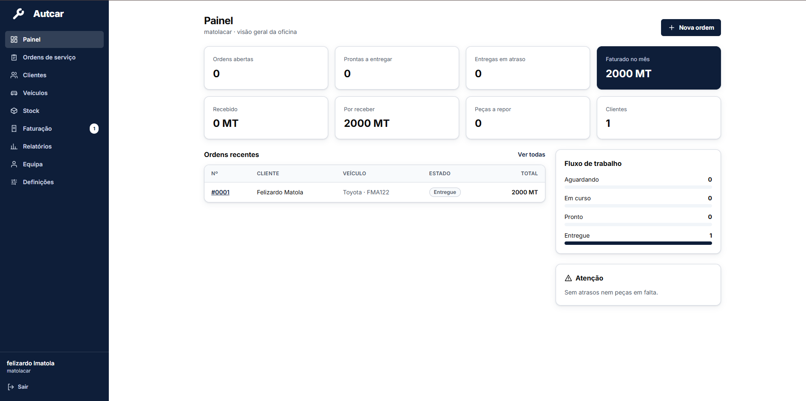

# Autcar — plataforma de gestão de oficinas


Aplicação web (SaaS) para oficinas mecânicas controlarem **ordens de serviço, clientes, veículos, stock de peças, faturação e equipa** num só lugar, do pedido do cliente à entrega e ao pagamento.

> **In short (EN):** a full-featured workshop-management web app built with Angular 19 (standalone components, signals), TypeScript and Tailwind CSS, with authentication (email/password + Google OAuth) and row-level-security-protected profiles on Supabase. It models real business rules: stock deduction, automatic invoicing on delivery, and delete-protection of linked records.



## O problema que resolve

Muitas oficinas ainda gerem tudo em cadernos e folhas soltas: perdem-se ordens, ninguém sabe que peças estão a acabar e as faturas por cobrar escapam. A Autcar centraliza o fluxo de trabalho e mostra, num painel, o que precisa de atenção hoje: entregas em atraso, peças a repor e dinheiro por receber.

## Funcionalidades

| Módulo | O que faz |
|---|---|
| **Painel** | Indicadores (ordens abertas, prontas, em atraso, faturado no mês, recebido, por receber), fluxo de trabalho por estado e alertas |
| **Ordens de serviço** | Abrir ordens, atribuir mecânico, lançar serviços e peças, mudar estado (Aguardando → Em curso → Pronto → Entregue), pesquisa e filtros |
| **Clientes e veículos** | Cadastros ligados entre si, com histórico e totais |
| **Stock** | Peças com SKU, custo e preço, ajuste rápido de quantidades e alerta de stock mínimo |
| **Faturação** | Fatura emitida automaticamente ao entregar a ordem, controlo de pagamentos e impressão |
| **Relatórios** | Faturação por mês, melhores clientes, desempenho da equipa e exportação para CSV |
| **Equipa e definições** | Colaboradores, dados da conta e cópia de segurança em JSON |
| **Autenticação** | Registo, login, Google, recuperação e redefinição de palavra-passe, completar perfil |

## Regras de negócio implementadas

- Marcar uma ordem como **Entregue** emite a fatura. Só se pode reverter se a fatura ainda não estiver paga.
- As peças lançadas numa ordem **saem do stock** (e não se lançam mais do que as existentes). Ao remover o item, voltam ao stock.
- Não se elimina um cliente, veículo ou peça que tenha ordens associadas.
- Cada conta tem os seus próprios dados, separados dos de outras contas.

## Destaques técnicos

- **Angular 19 moderno:** componentes *standalone*, **signals** (`signal`, `computed`, `effect`), controlo de fluxo nativo (`@if`, `@for`), `inject()`, guards funcionais e rotas por componente.
- **Autenticação com Supabase Auth:** email e palavra-passe e **Google OAuth**, com tratamento de erros traduzido para português e resultados tipados (*discriminated unions*), em vez de exceções soltas.
- **Base de dados com segurança por linha (RLS):** tabelas `profiles` e `google_accounts`, um **gatilho (*trigger*) em Postgres** que cria o perfil automaticamente em cada registo, e políticas em que cada utilizador só acede à sua própria linha. O SQL está em `supabase/migrations/`.
- **Guards de rota em dois níveis:** exige sessão iniciada e perfil completo. Contas Google novas passam por `/completar-perfil` antes de entrar na plataforma.
- **Interface responsiva:** menu lateral em computador e barra superior com menu deslizante em telemóvel. Estilos de impressão próprios para a fatura.
- **Detalhes de qualidade:** formulários reativos com validação, diretiva própria para campos só numéricos (telemóvel com 9 dígitos), atributos de acessibilidade (`aria-*`, `role="alert"`, `label` em todos os campos) e rotas SPA.
- **Design system leve:** paleta própria em `tailwind.config.js` (azul `#0B1F3A`, preto e branco) e classes reutilizáveis (`.btn`, `.card`, `.inp`, `.tbl`).

## Arquitetura

```
src/app
├── core/      models.ts (domínio) · data.service.ts (dados e regras) · auth.service.ts (Supabase) · auth.guard.ts
├── pages/     uma página por módulo (painel, ordens, clientes, veículos, stock, faturação, relatórios, equipa…)
├── shared/    menu lateral, modal, ícones, logótipo, campo de palavra-passe, botão Google, diretivas
supabase/migrations/   SQL das tabelas, gatilho e políticas RLS
```

Separação de responsabilidades: as páginas só apresentam e recolhem dados; **todas as regras de negócio vivem no `DataService`**, o que facilita testá-las e trocar o armazenamento sem mexer na interface.

## Como executar

Requisitos: Node.js 18.19+ (ou 20+) e npm.

```bash
npm install
npm start          # http://localhost:4200
npm run build      # gera dist/autcar/browser
```

### Ligar ao Supabase (para login, registo e Google)

1. Crie um projeto em [supabase.com](https://supabase.com) e execute o ficheiro `supabase/migrations/20261116000000_contas.sql` no *SQL Editor*.
2. Em `src/environments/environment.ts`, preencha o `supabaseUrl` e a chave **publishable** (pública por desenho, a segurança vem das políticas RLS). **Nunca** use a chave `service_role`.
3. *Authentication → URL Configuration:* adicione `http://localhost:4200/**` aos *Redirect URLs*.
4. *Google (opcional):* crie um *OAuth client ID* (tipo Web) no Google Cloud com o *redirect URI* `https://<ref-do-projeto>.supabase.co/auth/v1/callback` e cole o Client ID e o Client Secret em *Authentication → Providers → Google*.
5. Para usar a recuperação de palavra-passe e a confirmação de email em produção, configure um SMTP próprio em *Authentication → SMTP Settings*.

A plataforma começa vazia: registe primeiro a equipa, clientes, veículos e peças.

## Estado do projeto e próximos passos

Sou transparente sobre o que está pronto e o que falta:

- ✅ Interface completa, regras de negócio, autenticação e perfis no Supabase com RLS.
- 🔄 **Os dados da oficina** (clientes, ordens, stock…) estão guardados no navegador (`localStorage`), separados por conta. O próximo passo é migrar o `DataService` para tabelas do Supabase com RLS por conta, mantendo as mesmas assinaturas dos métodos.
- 🔄 Testes automatizados (unitários para as regras do `DataService` e testes de ponta a ponta nos fluxos principais).
- 🔄 Pagamentos parciais, envio de fatura por email/WhatsApp e permissões por função (dono, mecânico, balcão).

## Autor

**Felizardo Lázaro Matola** — Desenvolvedor Full Stack e Designer, Beira, Moçambique.

- GitHub: [github.com/felizardolmatola](https://github.com/felizardolmatola/felizardolmatola)
- Email: felizardolmatola@gmail.com
